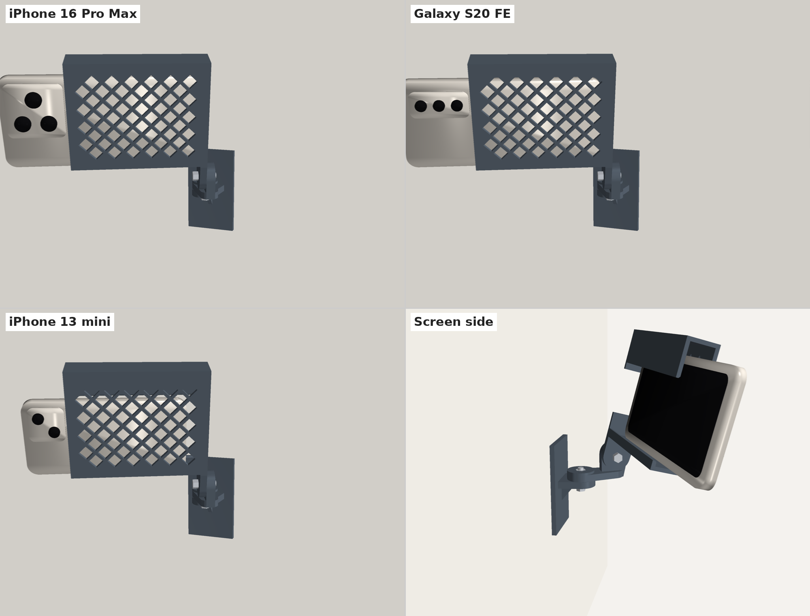

# Phone Wall Mount

A 3D-printable wall mount that holds a phone in landscape for filming. It sticks to the wall with Command strips — no screws in the wall.

| Version | Joints | Status |
|---|---|---|
| [v1](v1/) | Pan + tilt, clamped with 2× M5 bolts | Printed and tested; bolt direction since flipped for high mounting |
| [v2](v2/) | Pan + tilt, magnetic toothed joints (12× 5×2 mm magnets), no bolts | Designed, not yet printed |

## Compatible phones

One cradle fits all of these, bare or in a case:

- iPhone 16 Pro Max (up to ~81 mm wide and ~13 mm thick with a case)
- Samsung Galaxy S20 FE
- iPhone 13 mini

Anything between about 64 and 81 mm wide (short side, case included) and up to ~13 mm thick should fit. The camera bump overhangs the open end of the cradle so nothing blocks the lens.

## License

Not yet chosen.
