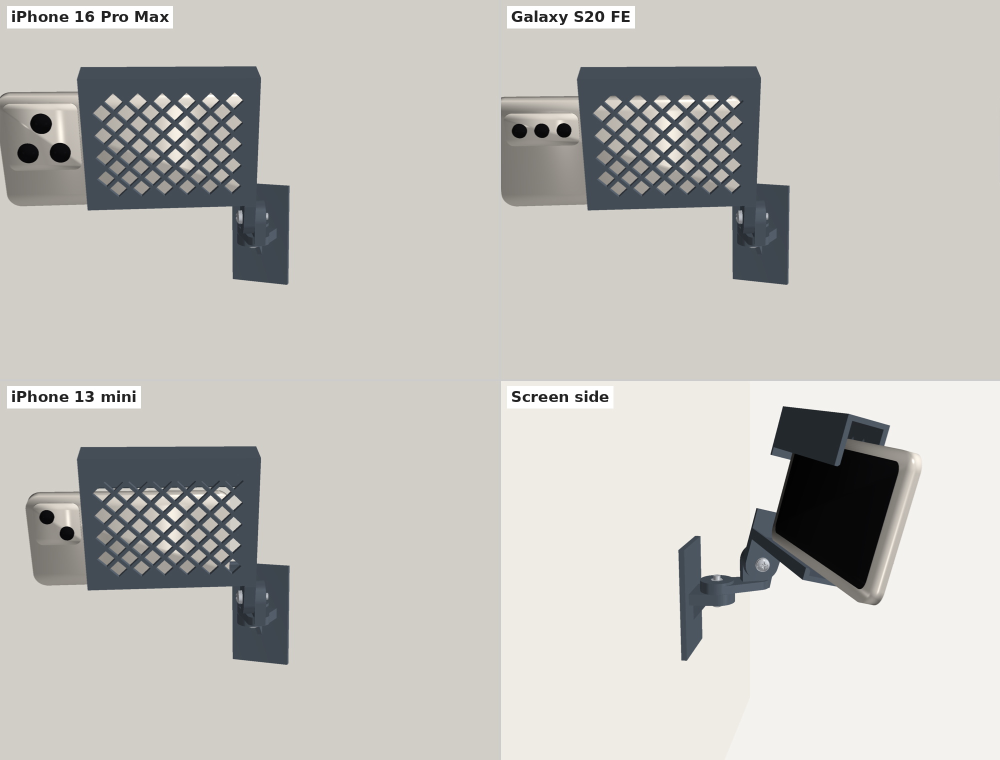
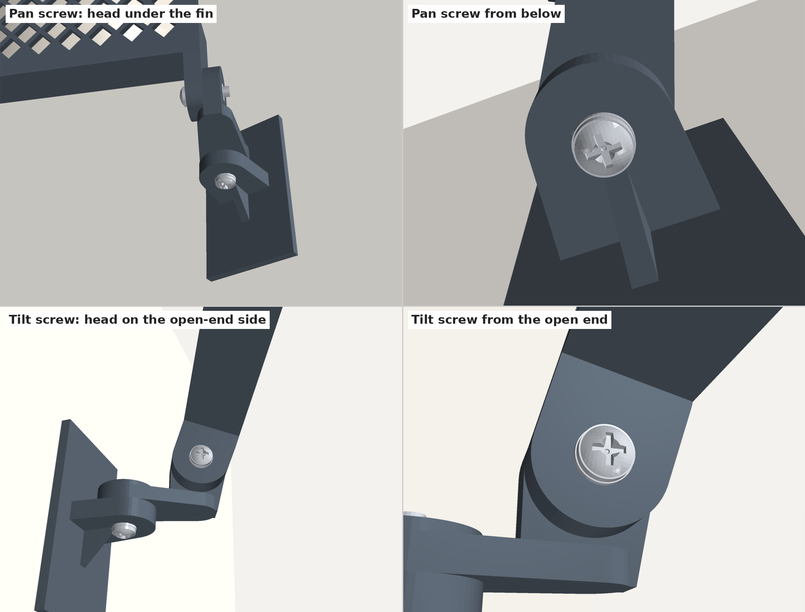
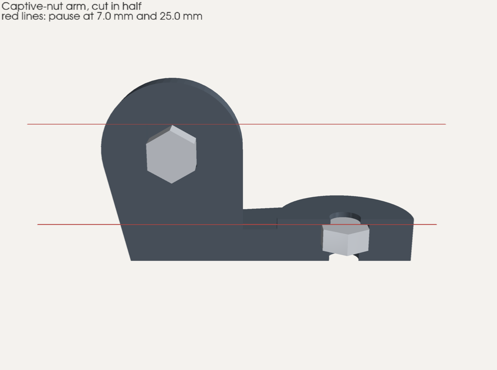
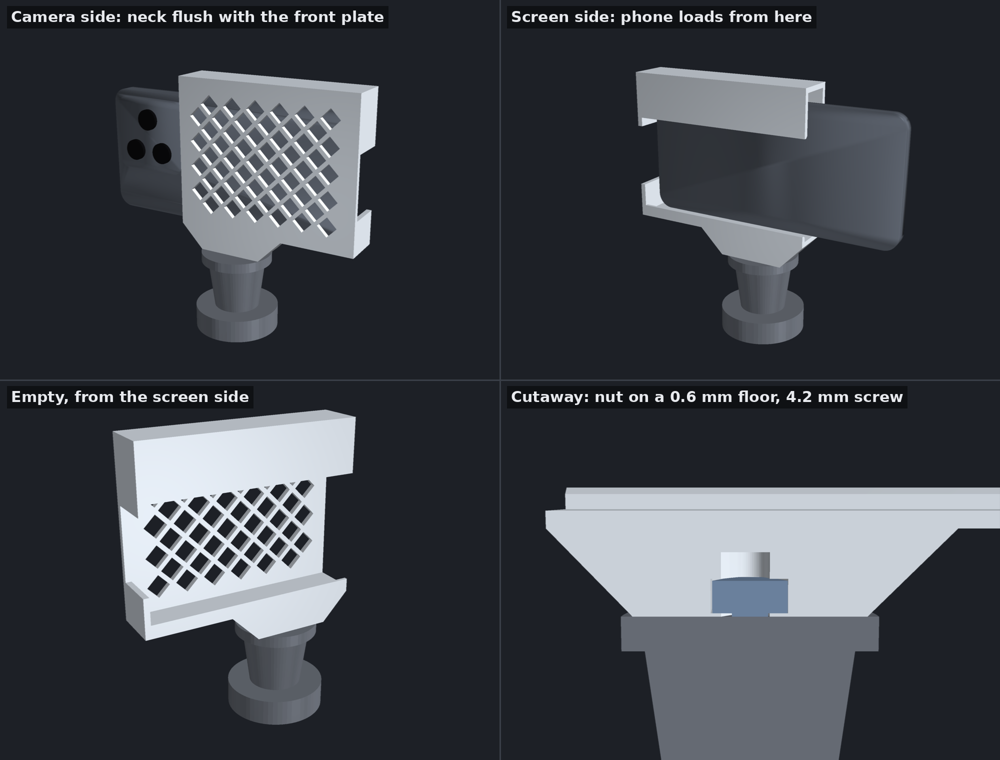
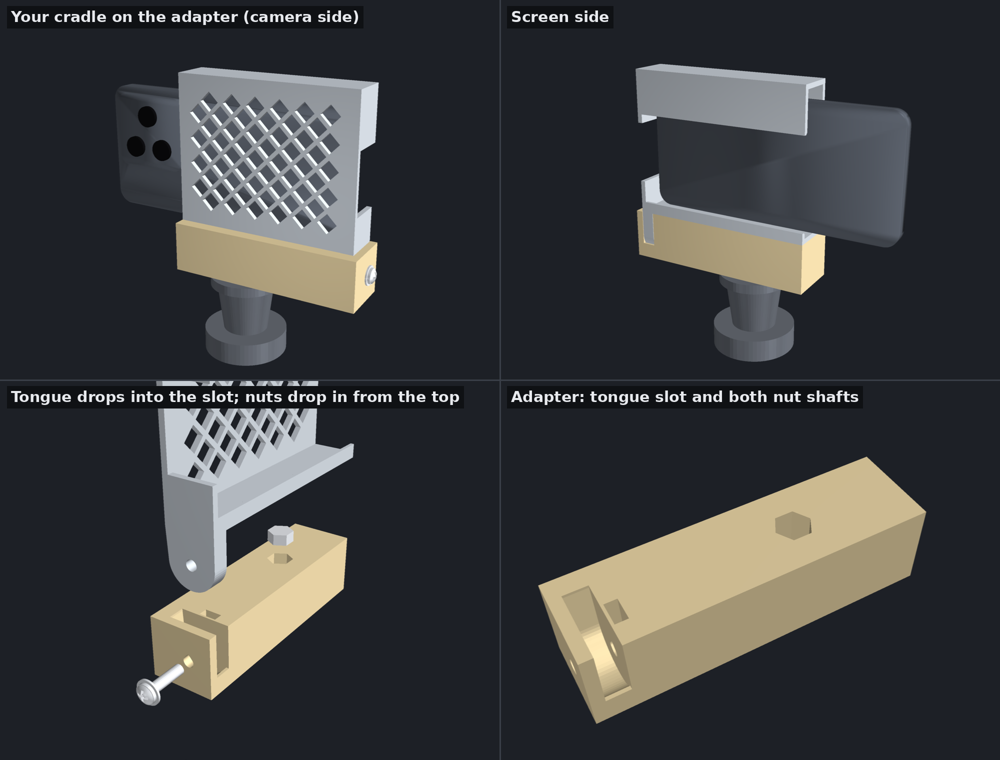
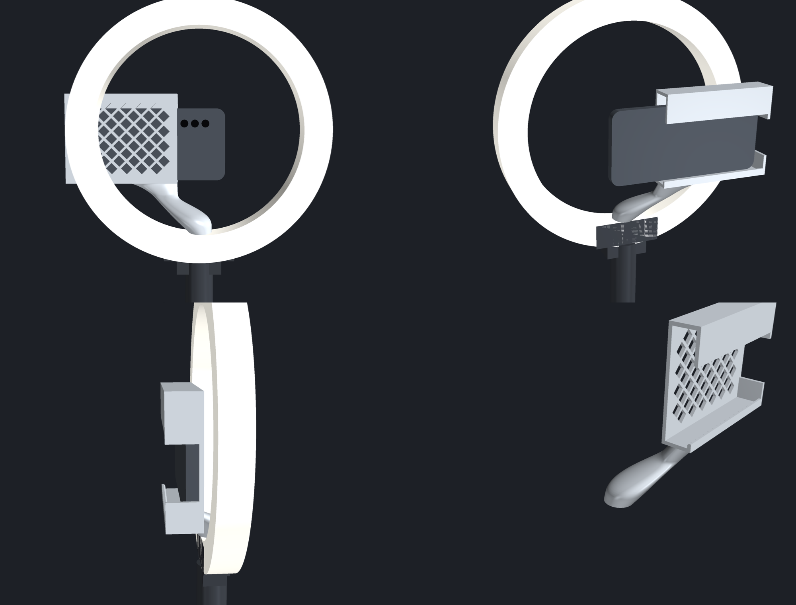
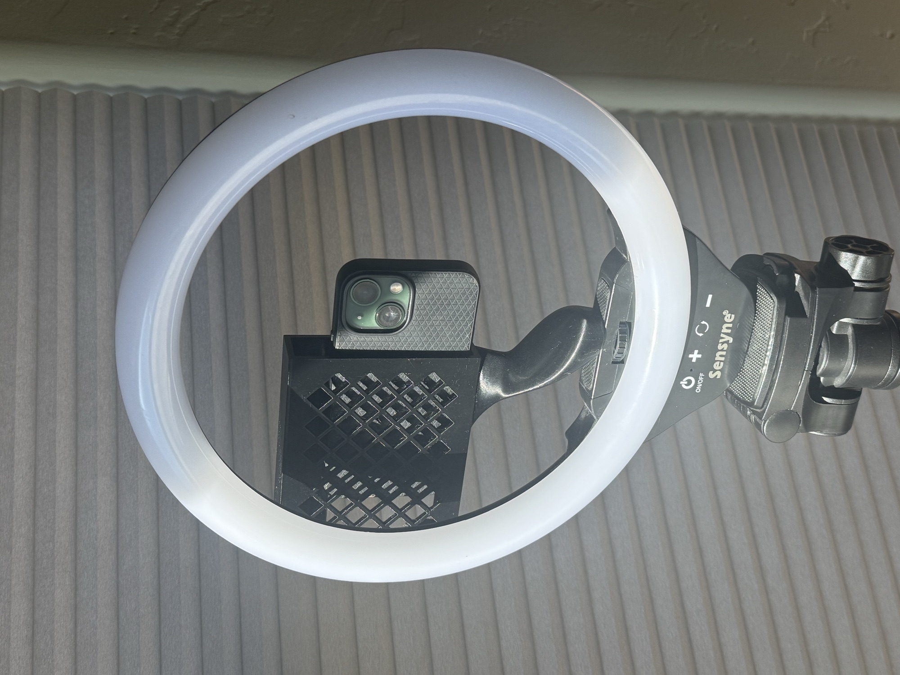

# Phone Wall Mount — v1

Three printed parts joined by two M5 screws:

1. **Wall plate** — sticks to the wall with Command strips. A horizontal fin forms the **pan** joint.
2. **Arm** — 30 mm between pivots. Flat disc at the wall end (pan), upright disc at the far end (**tilt**).
3. **Cradle** — holds the phone in landscape. The phone's back lies flat against a diamond-mesh front plate, and the camera bump hangs just past the open end.



Each joint has a **hex nut pocket on both of its outer faces**, so you choose which side the screw head goes on and put the nut in the pocket on the other side:

| Joint | Outer face 1 | Outer face 2 |
|---|---|---|
| Pan (wall plate ↔ arm) | Underside of the wall-plate fin | Top of the arm's round boss |
| Tilt (arm ↔ cradle) | Cradle tongue, open-end side | Arm's upright plate, outer side |

For a mount up high, the suggested setup (shown below) puts the **pan head under the fin**, adjusted from below, and the **tilt head on the cradle's open-end side**, where the phone slides in.



## Files

| Path | What it is |
|---|---|
| `3mf/phone_mount_v1_right_project.3mf` | **Bambu Studio project, ready to print**: H2D, Generic PETG, 4 walls, 30% gyroid, 5 mm brim, plus a 12 mm (washer-sized) 100% infill cylinder around each bolt: one on the wall-plate fin, two on the arm, one on the cradle tongue |
| `3mf/phone_mount_v1_right_captive_nuts_project.3mf` | Same, with the captive-nut arm and both nut pauses (7.20 and 25.20 mm) already added. The wall plate and cradle in this version have no nut pockets, just flat faces for the screw heads. |
| `3mf/..._left_project.3mf`, `..._left_captive_nuts_project.3mf` | Left-cradle versions of both projects |
| `3mf/phone_mount_plate_right.3mf` | All three parts on one plate, geometry only (any slicer) |
| `3mf/phone_mount_plate_left.3mf` | Same, with the mirrored cradle |
| `stl/wall_plate.stl` | Wall plate, already in print orientation |
| `3mf/phone_mount_plate_right_captive_nuts.3mf`, `..._left_captive_nuts.3mf` | Same plates with the **captive-nut arm** (nuts sealed inside during printing) |
| `stl/arm.stl`, `stl/arm_left.stl` | Arm for the right cradle, and its mirror image for the left cradle |
| `stl/arm_captive.stl`, `stl/arm_captive_left.stl` | Captive-nut versions of the arm |
| `stl/wall_plate_no_pocket.stl`, `stl/cradle_*_no_pocket.stl` | Wall plate and cradle for the captive-nut build (flat faces, no nut pockets) |
| `stl/cradle_right.stl`, `stl/cradle_left.stl` | The cradle and its mirror image — print one, with the matching arm |
| `src/wall_phone_mount.py` | Parametric generator for all parts |
| `src/fitcheck.py` | 2D simulation that checks a phone can be loaded and removed |

### Left or right cradle?

The cradle attaches to the arm at one end, so the phone sticks out to one side of the pivot. It can swing about 90° away from the wall but only 15–20° toward it. Pick the side that points the long end away from the wall. For straight-on filming (a few degrees of swivel), either one works. Print the matching arm: `arm.stl` with the right cradle, `arm_left.stl` with the left (the 3MF plates already pair them).

## Hardware

- 2× **M5 × 20 mm Phillips pan-head** machine screws (thumb screws also work for tool-free aiming)
- 2× **M5 hex nuts**, standard 8 mm across flats. Nylon-insert lock nuts are too thick for the pockets.
- 2× **M5 flat washers** (10–12 mm OD; the project files make a 12 mm solid zone under each), one under each screw head. The head sits over the unused hex pocket on its side, and the washer gives it a full flat face to bear on.
- 1–2× **Command Large** strips (the plate is 46 × 80 mm; two side by side is best)
- Optional: thin adhesive foam or rubber on the front plate to stop sliding

## Printing

Tested on a Bambu Lab H2D with PETG.

| Setting | Value |
|---|---|
| Filament | PETG (PETG HF ideal); PLA OK indoors |
| Process | 0.20 mm Standard |
| Wall loops | 4 |
| Infill | 30 % gyroid |
| Supports | Off — every part is designed to print without them |
| Brim | Outer brim only, 5 mm (needed for the tall cradle) |
| Around the screw holes | **100 % infill** (see below) |

### Solid infill around the screws

The plastic the screws clamp should be solid so it doesn't crush when you tighten. The `*_project.3mf` files already include this. If you use the geometry-only plates instead, set it in Bambu Studio. It takes about a minute:

1. **Arm** and **wall plate:** right-click each → *Edit Process Settings* → *Strength* → *Sparse infill density* **100 %**. Both are small, so making the whole part solid costs only about 15 g of extra filament.
2. **Cradle:** right-click it → *Height range Modifier*, set the range to **0–10 mm**, then set that range's *Sparse infill density* to **100 %**. The cradle prints standing on its closed end, so its screw tongue is the bottom 8 mm of the print.

When you open the 3MF, Bambu Studio says *"The 3mf file has invalid config, load geometry data only"*. Click OK — the file contains geometry only, and your own printer settings are used.

## Option: nuts sealed inside the arm (captive nuts)

Instead of pressing the nuts into open pockets afterwards, the captive-nut arm has two closed cavities. You pause the print, drop a nut into each, and the printer seals them in. The nuts can't fall out or spin, and there's nothing to line up during assembly.



- **Pan nut:** lies flat inside the arm's round end.
- **Tilt nut:** stands on edge inside the upright plate, corner down in a V seat.
- Because the nuts are sealed in, the screws always go in from the other side: the **pan screw up from under the wall-plate fin**, and the **tilt screw from the cradle's open-end side**.
- The wall plate and cradle in the captive-nut files have **no nut pockets**. The screw heads and washers sit on flat, solid faces.

**Adding the pauses in Bambu Studio**

The `*_captive_nuts_project.3mf` files already contain both pauses. To add them yourself to a geometry-only plate:

1. Open `phone_mount_plate_right_captive_nuts.3mf` (or the `_left` one) and slice.
2. In *Preview*, drag the vertical layer slider to **7.20 mm**. That's the first layer that roofs over the flat pan-nut cavity. Right-click the slider's handle and choose **Add pause**.
3. Do the same at **25.20 mm**, the first layer that roofs over the tilt-nut slot.
4. Check each pause in the preview. The layer just below it should still show the cavity open, and the paused layer should start covering it.

**At each pause:** drop an M5 nut into the open cavity. For the tilt nut, drop it in on edge so it settles corner-down into the V at the bottom. Press it down so nothing sticks up: the nut sits 0.4–0.6 mm below the next layer. Then resume.

The cavity roofs are printed as short bridges right over the nuts, so expect them to look a little rough from underneath. That doesn't matter, because the roofs carry no load.

## Assembly

1. Decide which side each screw head goes on, and press a nut into the hex pocket on the **other** side. For the suggested setup, both nuts go in the arm: one in the top of the round pan boss, one in the outer face of the upright tilt plate.
2. **Pan:** set the arm on top of the wall-plate fin. Put a washer on the screw and push it through the fin and arm into the nut (suggested: up from **underneath** the fin).
3. **Tilt:** hold the cradle's tongue against the arm's upright plate. Put a washer on the screw and push it through the tongue and plate into the nut (suggested: from the cradle's **open-end** side).
4. Clean the wall and the back of the plate with rubbing alcohol. Apply the Command strips with the pull tabs hanging below the plate, press for 30 s, and wait an hour before loading a phone.
5. Loosen both screws slightly, aim, and snug them down. With the suggested setup and the mount up high, you reach the pan screw from below and the tilt screw from the phone's open end.

## Loading the phone

The phone loads from the screen side (toward the wall), lift-and-hook style:

- **In:** tip the top edge up under the deep top lip, swing the bottom past the low bottom lip, let it drop. Slide it until the camera bump just clears the open end.
- **Out:** lift it about 5 mm, tip the bottom toward you, pull it down and out.

## Strength

With a cased iPhone 16 Pro Max (~270 g), the whole assembly hangs about 330 g. Aimed 45° down (worst case), the tilt joint sees about 0.14 N·m against roughly 2.5 N·m of clamping friction from a hand-tightened M5. The weakest plastic spot, the root of the wall-plate fin, has about 5× margin in PETG.

The real limit is the Command strip: the phone's weight tries to peel the top edge of the plate off the wall. Use two Large strips on a smooth, cured painted wall.

## Customizing

Edit the constants at the top of `src/wall_phone_mount.py` and run it:

```bash
pip install manifold3d trimesh
python3 wall_phone_mount.py   # writes STLs to ./out/
```

| Parameter | Default | Effect |
|---|---|---|
| `PHONE_W_MIN` / `PHONE_W_MAX` | 64 / 81 mm | Range of phone widths (short side, with case) |
| `INNER_DEPTH` | 19 mm | Channel depth; fits phones up to ~13 mm thick |
| `CRADLE_LEN` | 112 mm | Set so the longest phone's camera bump just overhangs |
| `ARM_LEN` | 30 mm | Pivot spacing; ~40 mm of loading room behind the cradle |
| `MESH_FRONT`, `MESH_HOLE`, `MESH_RIB`, `MESH_BORDER` | on, 12, 2.4, 5 mm | Diamond mesh in the front plate |

`src/fitcheck.py` needs `shapely` and checks that a phone of a given size can be loaded and removed.

## Tripod mount

Two ways to put the cradle on a standard **1/4"-20** tripod screw. Neither has a tilt joint: aim with the tripod head.

| | One piece (recommended) | Two pieces |
|---|---|---|
| Parts | Cradle and base printed as one part | Adapter block + cradle, joined by one M5 screw |
| Strength | Strongest: no joint, and every layer crosses the base-to-cradle junction | Strong: cradle floor rests on the block, tongue captured in a slot |
| Hardware | One 1/4"-20 nut | One 1/4"-20 nut, M5 × 20 screw, M5 nut, washer |
| Pauses | One (or none, with the slide-in nut version) | None |

### One piece



- **Tapered neck.** Instead of a full-length block, a short neck under the nut gives the tripod a 40 × 25 mm flat face, flush with the cradle on both sides. It joins the cradle over 70 mm and tapers at 45° at both ends, which saves about 30 cm³ (~35–40 g) of filament. The cradle's tall front plate already makes it stiff along its length. The 45° tapers mean no flat ceilings when printed on end. The rest of the neck uses your normal 30% infill.
- **No weak layer lines.** It prints standing on its closed end, like the cradle, so every layer runs across the joint between base and cradle.
- **Steel thread.** A 1/4"-20 hex nut sits on a 0.6 mm floor, centered under the cradle + phone center of gravity (within 4 mm for all three phones). Tightening the tripod screw pulls the nut down and squeezes that floor flat against the tripod plate. It can't bend or pull through, and the pressure stays under about 7 MPa even at 500 N, far below what crushes PETG. So tightening hard won't damage it, and no washer is needed.
- **Solid only where it's clamped.** The project files put a 20 mm 100% infill column under the nut, from the tripod face up through the nut.
- **Blind screw hole.** Even a long tripod screw stops 4 mm short of the phone.

| File | What it is |
|---|---|
| `3mf/tripod_cradle_captive_project.3mf` | Ready to print. **Pause at 87.60 mm**: drop the 1/4"-20 nut into the slot corner-down, then resume |
| `3mf/tripod_cradle_project.3mf` | No pause: slide the nut into its slot from the base's side face after printing |
| `stl/tripod_cradle*.stl` | Geometry only |

The nut slot is sized for a measured 10.9 mm (across flats) × 5.48 mm nut, with 0.3 mm of clearance so it can only turn about 3° before it locks. For a different nut, change `T_NUT_AF` and `T_NUT_H` and regenerate. The design assumes a tripod screw that sticks up **4.2 mm** (`SCREW_REACH`), which engages 3.6 mm (about 3 threads) of the nut. If your tripod's screw is longer, you can add a washer under the nut (`WASHER_OD`, `WASHER_T`) and regenerate.

### Two pieces: adapter + cradle

A single printed block that holds a standard cradle (newly printed or one you already have) on the tripod.



- **Fits any v1 cradle.** The cradle's tongue drops into a fitted slot, and one M5 screw goes through the tongue's existing hole. It fits cradles with or without the nut pocket.
- **Strong, and can't rotate.** The cradle's floor rests on the block's flat top for 107 mm of its length, so the phone's weight goes into the block, not the screw. The tongue is held on both faces and around its rounded bottom, so the cradle can't rotate even 1° if the screw loosens.
- **Balanced.** The 1/4"-20 nut sits within 4 mm of the cradle + phone center of gravity for all three phones.
- **No print pauses and no supports.** It prints upright on its flat bottom. Both nuts drop into shafts from the top face before the cradle goes on, and the cradle then covers them.

**Files:** `3mf/tripod_adapter_project.3mf` is ready to print, with 100% infill around the tongue seat, the M5 nut and the tripod nut. `stl/tripod_adapter.stl` is geometry only.

**Hardware:** one **1/4"-20 hex nut** (7/16" across flats), one **M5 × 20** screw, one M5 nut and one washer.

#### Assembly

1. Drop the 1/4"-20 nut into the hex shaft in the middle of the block. It falls to the floor near the bottom.
2. Drop the M5 nut into the narrow shaft next to the tongue slot, flats vertical. It settles into a V at the bottom, lined up with the screw.
3. Lower the cradle's tongue into the slot, so the cradle floor sits flat on the block.
4. Put the washer on the M5 screw and drive it in from the closed-end face, through the cheek and tongue into the nut.
5. Screw the adapter onto the tripod.

**Tongue thickness:** the slot is sized for an 8 mm tongue, which is every cradle printed since the "nut pockets on both sides" change. If yours measures 6 mm, set `TONGUE_T_FIT = 6.0` in `src/tripod_adapter.py` and regenerate.

## Ring light mount (one piece)

The cradle on a riser that screws onto a ring light's 1/4"-20 phone screw, the one on the block inside the bottom of the ring. It holds the phone just behind the ring with its camera roughly at the ring's center. The wall and tripod cradles are unchanged.





Printed, on the reference ring light, holding an iPhone 13 mini.

- **Phone orientation:** camera end on the subject's right, lens near the top, as in the reference photo. That orientation needs the shortest riser, about 47 mm above the light's block.
- **Arm:** one continuous shape with no seams. It starts as a flat pad on the light's block, with the 1/4"-20 nut sealed inside (same nut and 0.6 mm floor as the tripod version). It narrows to a slim body, about 12.5 mm thick at its thinnest, and runs in a straight line up behind the ring. At the top it flares out into a footprint on the cradle's underside, meeting it tangentially like a fillet. Its far side reaches right out to the cradle's open end, so the arm meets the cradle at the very end. Every horizontal slice is an ellipse, and their size and position change smoothly from the pad to the cradle. The arm only reaches forward through the ring's opening above the block, so it never touches the ring. The cradle itself is the original shape, with the bottom lip running all the way to the open end.
- **Camera position:** side to side, the ring's center sits in the middle of the three phones' measured lens positions: 13 mini 4.0 mm one way, S20 FE 3.7 mm the other, 16 Pro Max on center. Up and down, they're within about 7 mm, using estimated lens heights.
- **Printing:** standing on the cradle's closed end, no supports. The arm leans about 47° from vertical in that orientation, and the steepest spot on its underside is about 53°, which PETG bridges cleanly without supports. Everything else is within 45° except the small bridge over the nut. About 76 cm³ of plastic.

| File | What it is |
|---|---|
| `3mf/ring_light_cradle_captive_project.3mf` | Ready to print. **Pause at 144.40 mm**: drop the 1/4"-20 nut into its slot corner-down, then resume |
| `3mf/ring_light_cradle_project.3mf` | No pause: slide the nut in from the pad's front face after printing |
| `stl/ring_light_cradle*.stl` | Geometry only |

**Light dimensions.** These values set the camera height and the gap behind the ring. All of them are measured on the reference light. They're at the top of `src/ring_light_cradle.py`:

| Parameter | Current value | What to measure |
|---|---|---|
| `SCREW_TO_CENTER` | 101.6 mm (measured) | From the top surface of the mounting block, where the screw comes out, up to the ring's center: 8" to the inner top edge, minus the 4" radius |
| `SCREW_TO_BACK` | 10.5 mm (measured) | From the center of the screw back to the back face of the ring, on the side you stand |
| `CLR_BACK` | 10 mm | Gap between the ring's back face and the cradle's front plate |
| `SCREW_REACH` | 5.3 mm (measured) | How far the light's screw sticks up. At 5.3 mm it engages 4.7 mm of the nut, about 3.7 threads, and stops 4 mm short of the end of its hole |
