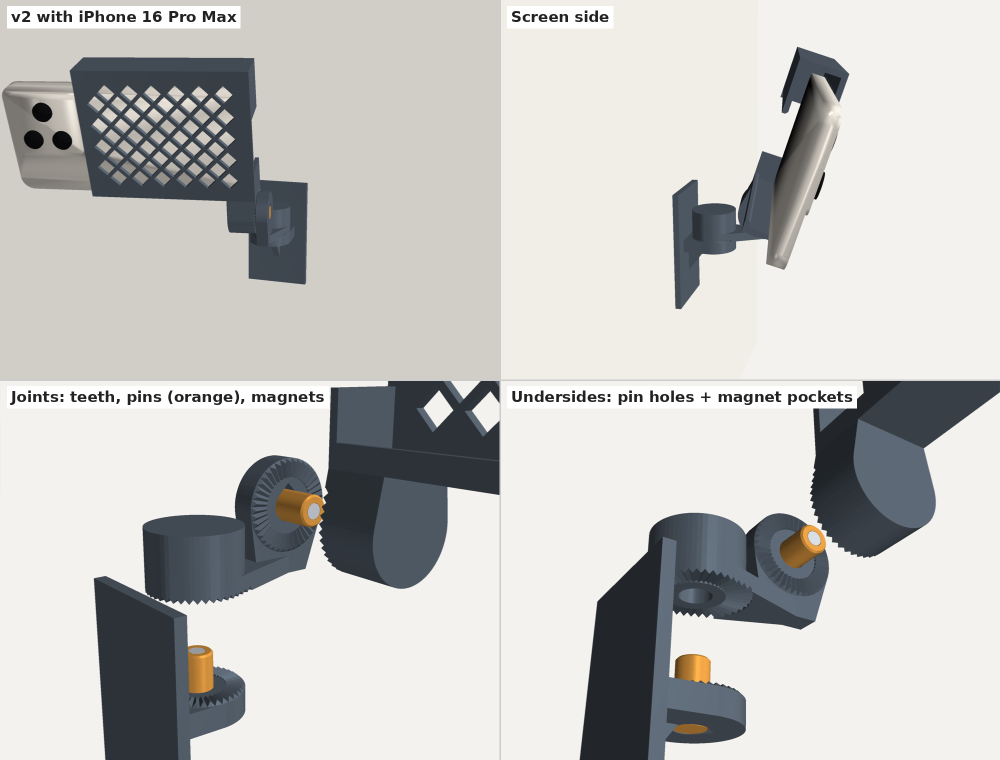

# Phone Wall Mount — v2 (magnetic joints, no bolts)

Same wall plate, arm and lift-and-hook cradle as [v1](../v1/), but the two M5 bolts are replaced by **magnetic toothed joints**.



## How the joints work

Each joint (pan at the wall, tilt at the cradle) is two discs that meet face to face:

- **Teeth.** 40 fine radial teeth on each face lock the aim in **9° notches**. Gravity can't turn the joint because the teeth are interlocked.
- **Magnets.** A stack of three 5 × 2 mm magnets in the tip of a center pin faces another stack of three in a pocket on the other side. They pull the faces together so the teeth stay engaged. Because the stacks sit on the joint's axis, they line up at every notch.
- **Center pin.** A printed 10 mm pin is glued into one side and slides into a hole in the other. It carries the sideways and prying loads, which magnets alone can't hold.

**To re-aim:** pull the part about 2 mm off the teeth (the pin keeps it lined up), turn it a notch or two, and let go. It snaps back. The cradle and the arm can also be pulled off their pins entirely, which makes them quick-release.

## Files

| Path | What it is |
|---|---|
| `3mf/fit_test.3mf` | **Print this first**: a small joint pair and one pin to check the fit |
| `3mf/phone_mount_v2_plate_right.3mf` | Wall plate, arm, cradle and 2 pins on one plate |
| `3mf/phone_mount_v2_plate_left.3mf` | Same with the mirrored cradle |
| `stl/` | Individual parts, already in print orientation |
| `src/wall_phone_mount_v2.py` | Parametric generator |

## What you need

- **12 neodymium magnets, 5 mm × 2 mm** (designed around 5 × 1.96 mm): one stack of 3 in each pin and one stack of 3 in each mating pocket
- **Super glue (CA) or 2-part epoxy** for the magnets and pins
- 1–2× **Command Large** strips
- A marker

No bolts or nuts.

## Printing

Same settings as v1: PETG, 0.20 mm Standard, **4 walls**, 30% gyroid, **supports off**, 5 mm outer brim on the cradle.

- Every part is designed to print without supports. The toothed faces of the arm and cradle print face-down on the bed. The holes above them end in small circular bridges, which print fine.
- The pins print standing up. With 4 walls they come out nearly solid.

## Fit test first (about 20 minutes)

`fit_test.3mf` is one tooth-and-pin joint at full size.

1. Push the pin into the socket of the flat piece (A) without glue.
2. Slide the tall piece (B) onto the pin. It should slide smoothly with almost no side-to-side wobble, and the teeth should drop fully into each other.
3. Lift B about 2 mm and turn it: it should turn freely and click into each notch.

- **Too tight:** increase `PIN_CLR` by 0.05 (or sand the pin lightly).
- **Wobbly:** decrease `PIN_CLR` by 0.05. Wobble here becomes sag in the real mount (see Strength below).
- **Teeth don't seat fully:** increase `TOOTH_CLR` by 0.1.

You can also use the fit test to try the magnets before gluing anything into the real parts.

## Assembly

**Get the magnet polarity right.** For each joint:

1. Glue a stack of 3 magnets into the bore in the tip of a pin, flush with the end.
2. Before the glue sets, set another stack of 3 on top of it. It will snap on the right way round.
3. Put a marker dot on the top (exposed) face of that second stack. Pull it off.
4. Glue that stack into the pocket at the end of the hole in the B part (arm underside or cradle tongue), **marked face in first**. The unmarked face, which was touching the pin's magnets, now faces the pin, so the two stacks attract.

**Pins.**

5. Glue one pin into the socket in the wall-plate fin and one into the socket in the arm's upright plate, magnet end out.
6. While the glue sets, slide the matching part onto the pin (without glue) to hold the pin square. Make sure no glue reaches that part.

**Mounting.**

7. Stick the wall plate up with Command strips. Press for 30 s and wait an hour before loading a phone.
8. Drop the arm onto the wall-plate pin, then push the cradle onto the arm's pin.

## Aiming range

You can swivel ±9° anywhere from 45° down to about 9° up, which is enough for filming straight on from the wall. ±18° works when tilted down. The checks used a cased iPhone 16 Pro Max and a 13 mini.

## Strength and sag

With a cased iPhone 16 Pro Max, the cradle and phone weigh about 320 g.

- **Holding the aim:** the teeth convert some of the turning load into a push that tries to lift the joint apart. Aimed straight out, the magnets only need to resist about 0.4 N. Tilted 18° down, about 2.4 N; at 45° down, about 5 N. A pair of 3-magnet stacks should manage that, but if the tilt slips at steep angles, use 4 magnets per stack (`MAG_STACK = 4`).
- **Sag:** the cradle hangs out to one side of the tilt joint, so its weight tries to pry the joint open. That's about 0.25 N·m, more than the magnets can resist, so the pin takes it. Any slack between pin and hole lets the cradle sag. That shows up as a slight **roll** of the image, at most about 1° with the default `PIN_CLR = 0.10`. It's always in the same direction. Tighten the fit with the fit test, or set `ROLL_COMP` to the sag you measure (for example `0.8`). That pre-tilts the arm's tilt plate so the phone sits level under load.

## Parameters (top of `src/wall_phone_mount_v2.py`)

| Parameter | Default | Effect |
|---|---|---|
| `TEETH` | 40 | Notch size = 360 / TEETH (9°). More teeth means finer notches but smaller teeth. |
| `FLANK` | 50° | Tooth steepness. Steeper holds better; above ~50° the teeth print less cleanly on vertical faces. |
| `PIN_CLR` | 0.10 mm | Pin-to-hole clearance (set from the fit test) |
| `TOOTH_CLR` | 0.25 mm | Tooth clearance |
| `MAG_STACK` | 3 | Magnets per stack |
| `MAG_T`, `MAG_POCKET_D` | 1.96, 5.25 mm | Magnet thickness and pocket diameter |
| `PIN_ENGAGE` | 12 mm | How deep the pin goes in. Longer means less sag but thicker parts. |
| `ROLL_COMP` | 0° | Pre-tilt to cancel cradle sag |

Everything else (phone sizes, cradle length, mesh, arm length) works as in v1.

```bash
pip install manifold3d trimesh
python3 wall_phone_mount_v2.py   # writes STLs to ./out/
```
