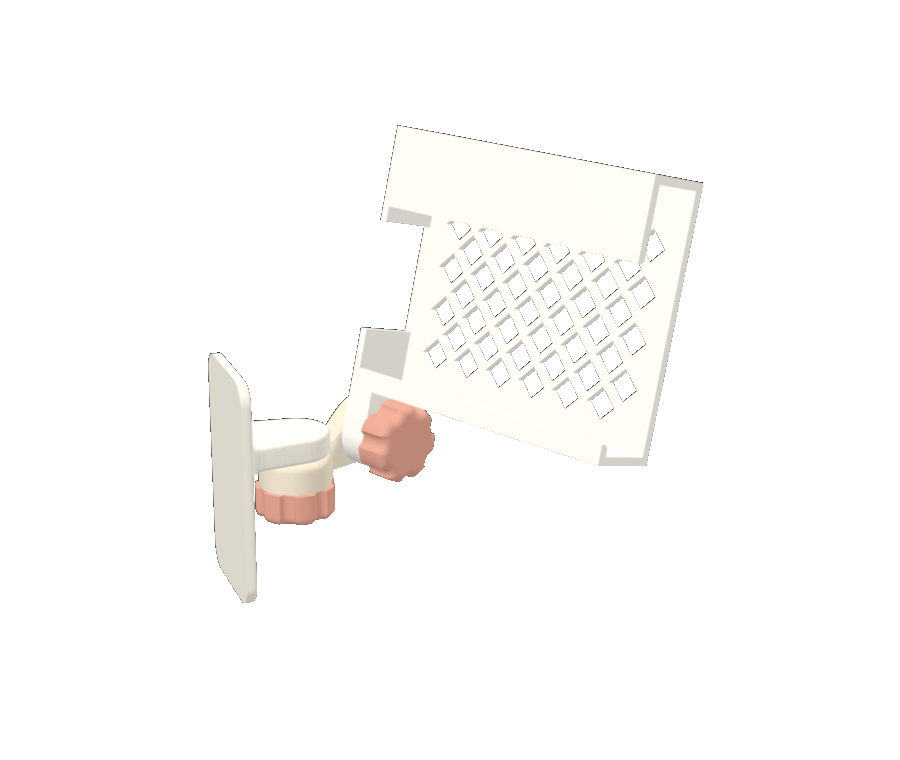
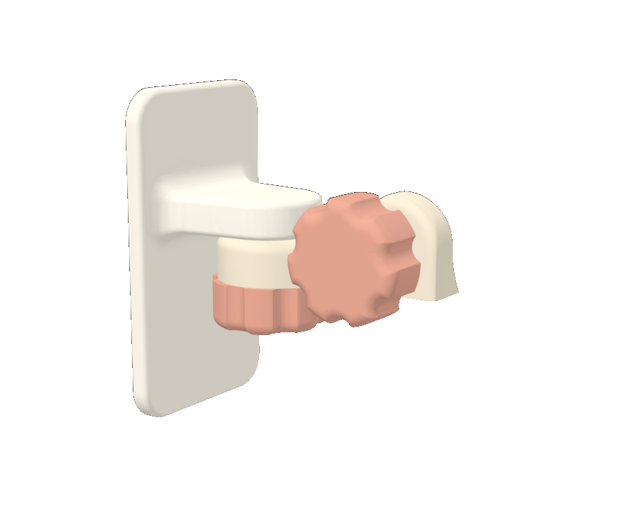
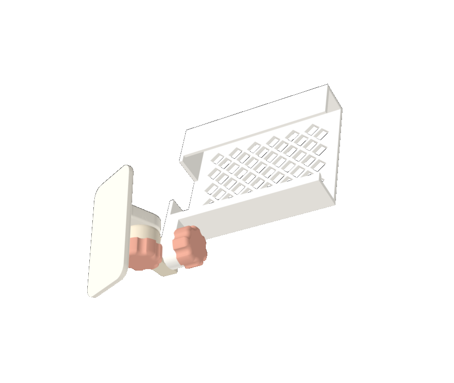
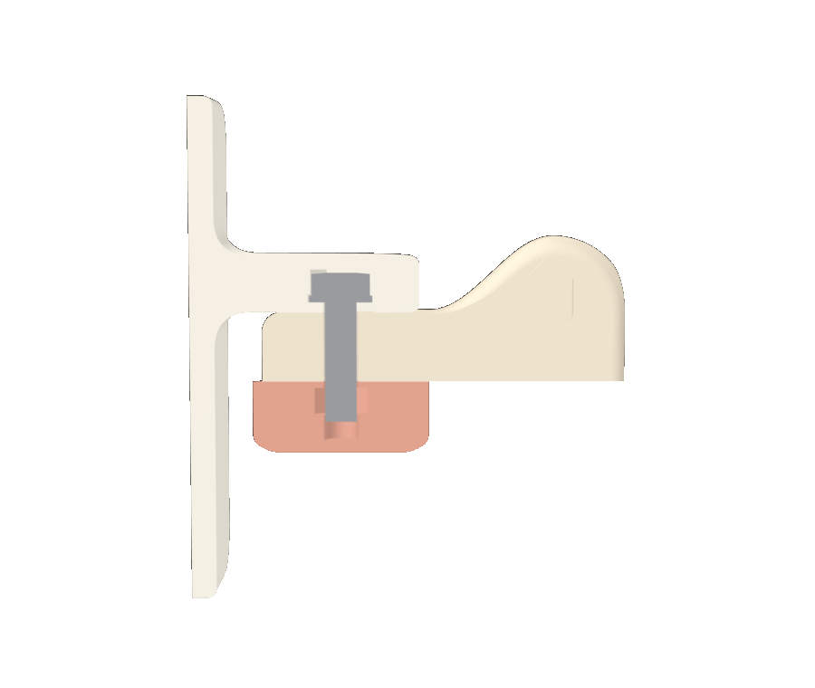
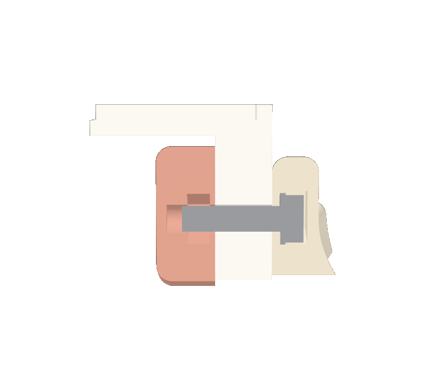

# Phone Wall Mount — v3 (sculpted arm, captive bolts, thumb knobs)

The same lift-and-hook cradle as [v1](../v1/), on a new arm and wall plate:

- **Sculpted arm and plate.** The arm is one smooth piece: a round pan puck that sweeps up into the upright tilt plate. The wall plate's fin blends into the plate with a large fillet. Both print without supports.
- **Nothing sticks out.** Each joint is sized for an **M5 × 20** bolt. When the joint is tight, the bolt's tip ends 1.4 mm past the nut, inside a blind bore in the knob. No threaded end shows. In v1, the 20 mm bolt was longer than the joint it clamped.
- **Nothing to lose.** Each bolt is sealed inside a part during a print pause, the same way v1's captive nuts are, and each nut is sealed inside a thumb knob. Aiming needs no tools: loosen a knob, aim, and tighten it.



| | |
|---|---|
|  |  |
|  |  |

**Status:** designed and checked in software, not yet printed. The project file slices cleanly in Bambu Studio (about 100 g of PETG and about 5 h on an H2D). The aiming range and fits come from the checks in `src/render_v3.py`, not from a test print.

## How the joints work

Each joint is a sealed bolt, the part it passes through, and a knob:

| Joint | Bolt sealed in | Passes through | Knob |
|---|---|---|---|
| Pan (vertical axis) | Wall-plate fin, threaded end pointing down | Arm's round puck (11 mm) | Under the puck, so you reach it from below when the mount is up high |
| Tilt (horizontal axis) | Arm's upright plate, threaded end toward the cradle | Cradle's tongue (11 mm) | Under the cradle floor, at the closed end |

- **The bolt can't turn.** Its hex head sits corner-down in a V-shaped pocket, so turning the knob only turns the knob.
- **The bolt can't come out.** The pocket is roofed over after the pause. A washer under the head spreads the clamping load over the 1.6 mm wall between the pocket and the joint face.
- **The knob's nut is sealed in** on a 1.0 mm floor. Tightening pulls the nut toward the joint, so that floor is squeezed between the nut and the joint face. It's only ever in compression.
- **Bolt length sets the joint thickness.** The stack is washer 1.0 + wall 1.6 + clamped part 11.0 + knob floor 1.0 + nut 4.0 + 1.4 past the nut = 20 mm. The knob's bore runs another 3 mm beyond the tip, which leaves room for tightening and for bolts that run a little long.

The arm and knobs are the same for either cradle side: print `arm_right` with the right cradle and `arm_left` with the left. To choose a side, see [Left or right cradle?](../v1/README.md#left-or-right-cradle) in v1. Older v1 cradles don't fit, because their tongue is 8 mm and the joint needs 11 mm.

## Files

| Path | What it is |
|---|---|
| `3mf/phone_mount_v3_right_project.3mf` | **Bambu Studio project, ready to print**: wall plate, right arm, right cradle and two knobs on one plate. It has the three pauses and the solid-infill zones around each bolt, with the same printer and filament settings as v1 (H2D, Generic PETG, 0.20 mm, 4 walls, 30% gyroid, 5 mm brim) |
| `3mf/phone_mount_v3_left_project.3mf` | Same, with the left arm and cradle |
| `stl/` | Each part on its own, already in print orientation (print two `knob.stl`) |
| `src/wall_phone_mount_v3.py` | Parametric generator. It reuses the cradle from `v1/src/wall_phone_mount.py` |
| `src/make_3mf_v3.py` | Writes the two project files, using v1's project as the settings template |
| `src/render_v3.py` | Renders the images and runs the checks: collisions across the aiming range, bolt tips inside the knobs, and overhangs |

## Hardware

- 2× **M5 × 20 hex-head bolts**, full thread (ISO 4017 / DIN 933, 8 mm across flats). They must be **hex head**: a round pan head would spin in its pocket. Socket-head cap screws don't fit the pocket.
- 2× **M5 hex nuts**, standard 8 mm across flats, 4 mm thick (ISO 4032). Nylon-insert lock nuts are too thick.
- 2× **M5 flat washers**, 10 mm OD × 1 mm (DIN 125)
- 1–2× **Command Large** strips (the plate is 46 × 80 mm, the same as v1)

If your bolts are a different length, change `BOLT_L` and regenerate. The arm puck and cradle tongue resize so the tip still ends inside the knob.

## Printing

Open a project file and slice. The pauses are already in it. If you print from the STLs instead, add these in Bambu Studio's preview: drag the layer slider to each height, right-click the handle, and choose **Add pause**.

| Pause at | What to do |
|---|---|
| **5.60 mm** | **Knobs:** drop an M5 nut flat into the hex pocket in each knob |
| **16.60 mm** | **Arm:** put a washer on a bolt and drop it into the slot on the upright plate. The head goes corner-down into the V, the washer into the round slot next to it, and the threaded end out through the joint face |
| **29.60 mm** | **Wall plate:** same, into the slot at the end of the fin |

Check that nothing sticks up above the layer about to print. The nut sits 0.4 mm below it, and the bolt head and washer 0.6–0.9 mm below. Then resume.

The bolt's threaded end sticks out of the part while the rest prints above it, about 17 mm sideways and level with the axis. That's expected: the print head only works above it from then on. The pocket is only 0.4 mm longer than the head, so the bolt can't droop more than about 2.5°. The project layout leaves clear space where each bolt sticks out, so keep that space clear if you move the parts around.

The roofs over the pockets print as short bridges and may look rough from underneath. That doesn't matter, because they carry no load.

## Assembly

1. **Tilt:** slide the cradle's tongue onto the arm's tilt bolt, then screw a knob onto the bolt under the cradle floor.
2. **Pan:** push the arm's puck up onto the pan bolt under the fin, then screw the other knob on from below.
3. Clean the wall and the back of the plate with rubbing alcohol. Apply the Command strips with the pull tabs hanging below the plate, press for 30 s, and wait an hour before loading a phone.
4. Aim, and tighten both knobs by hand.

Loading and removing the phone works the same as v1: [Loading the phone](../v1/README.md#loading-the-phone).

## Aiming range

Measured by `src/render_v3.py` (collision checks between every pair of parts, knobs included):

- **Pan:** about 190° in total, from −85° to +105° off straight out, at level tilt (mirrored for the left cradle)
- **Tilt:** from 90° camera-down to 35° camera-up. Past 35° up, the top of the cradle hits the wall.

## Customizing

Edit the constants at the top of `src/wall_phone_mount_v3.py` and run:

```bash
pip install manifold3d trimesh numpy
python3 wall_phone_mount_v3.py   # STLs into ../stl/
python3 make_3mf_v3.py           # project files into ../3mf/
pip install matplotlib pyrender
python3 render_v3.py             # checks + images into ../images/
```

| Parameter | Default | Effect |
|---|---|---|
| `BOLT_L` | 20 mm | Bolt length. It sets the clamped thickness of the arm puck and cradle tongue |
| `TIP_PAST_NUT`, `TIP_ROOM` | 1.4, 3 mm | How far the tip ends past the nut, and the extra bore depth beyond it |
| `PIV_Y` | 24 mm | Pan axis distance from the wall (finger room around the pan knob) |
| `ARM_LEN` | 34 mm | Pan axis to tilt axis |
| `FIN_Z` | 46 mm | Height of the fin's underside on the plate |
| `KNOB_R`, `KNOB_LOBES` | 14 mm, 7 | Knob size and grip |
| `ARM_FLARE`, `EDGE_R` | 3.5, 3 mm | How much the upright flares toward the bed, and the arm's edge rounding |

The phone-size settings (`PHONE_W_MIN`, `PHONE_W_MAX`, `INNER_DEPTH`, `CRADLE_LEN`) are in `v1/src/wall_phone_mount.py`, because the cradle is shared.
