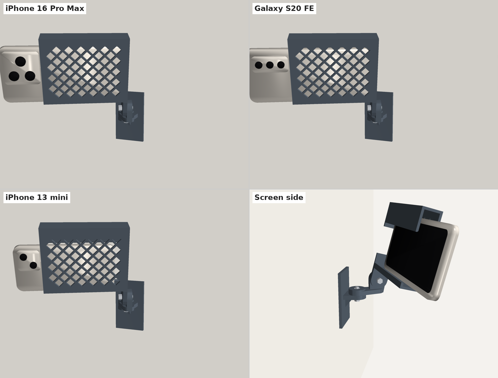
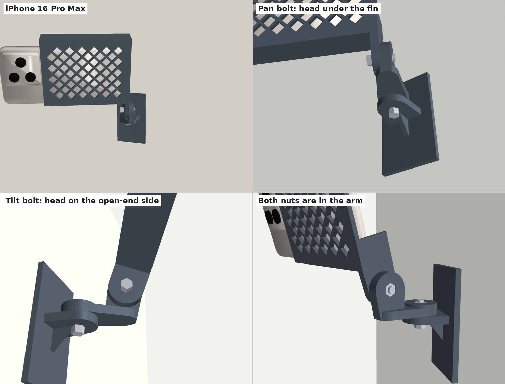

# Phone Wall Mount — v1

Three printed parts joined by two M5 bolts:

1. **Wall plate** — sticks to the wall with Command strips. A horizontal fin forms the **pan** joint.
2. **Arm** — 30 mm between pivots. Flat disc at the wall end (pan), upright disc at the far end (**tilt**). Both nuts sit in the arm.
3. **Cradle** — holds the phone in landscape. The phone's back lies flat against a diamond-mesh front plate, and the camera bump hangs just past the open end.



Both bolt heads face the directions you reach from when the mount is up high:

- **Pan bolt:** the head is **under** the wall-plate fin, so you can adjust it from below.
- **Tilt bolt:** the head is on the cradle's **open-end** side, where the phone slides in.



## Files

| Path | What it is |
|---|---|
| `3mf/phone_mount_plate_right.3mf` | All three parts on one plate, ready for Bambu Studio |
| `3mf/phone_mount_plate_left.3mf` | Same, with the mirrored cradle |
| `stl/wall_plate.stl` | Wall plate, already in print orientation |
| `stl/arm.stl`, `stl/arm_left.stl` | Arm for the right cradle, and its mirror image for the left cradle |
| `stl/cradle_right.stl`, `stl/cradle_left.stl` | The cradle and its mirror image — print one, with the matching arm |
| `src/wall_phone_mount.py` | Parametric generator for all parts |
| `src/fitcheck.py` | 2D simulation that checks a phone can be loaded and removed |

### Left or right cradle?

The cradle attaches to the arm at one end, so the phone sticks out to one side of the pivot. It can swing about 90° away from the wall but only 15–20° toward it. Pick the side that points the long end away from the wall. For straight-on filming (a few degrees of swivel), either one works. Print the matching arm: `arm.stl` with the right cradle, `arm_left.stl` with the left (the 3MF plates already pair them).

## Hardware

- 2× **M5 × 16 mm** bolts (socket head, or thumb screws for tool-free aiming)
- 2× **M5 hex nuts**, standard 8 mm across flats. Nylon-insert lock nuts are too thick for the pockets.
- Optional: 2× M5 flat washers
- 1–2× **Command Large** strips (the plate is 46 × 80 mm; two side by side is best)
- Optional: thin adhesive foam or rubber on the front plate to stop sliding

## Printing

Tested on a Bambu Lab H2D with PETG.

| Setting | Value |
|---|---|
| Filament | PETG (PETG HF ideal); PLA OK indoors |
| Process | 0.20 mm Standard |
| Wall loops | 4 |
| Infill | 30 % gyroid |
| Supports | Off — every part is designed to print without them |
| Brim | Outer brim only, 5 mm (needed for the tall cradle) |

When you open the 3MF, Bambu Studio says *"The 3mf file has invalid config, load geometry data only"*. Click OK — the file contains geometry only, and your own printer settings are used.

## Assembly

1. Press the two M5 nuts into the hex pockets in the arm: one in the top of the round pan boss, one in the outer face of the upright tilt plate (the face away from the cradle).
2. **Pan:** set the arm on top of the wall-plate fin and push the bolt up **from underneath** the fin, through the fin and arm, into the nut.
3. **Tilt:** hold the cradle's tongue against the arm's upright plate and push the bolt in **from the cradle's open-end side**, through the tongue and the plate, into the nut.
4. Clean the wall and the back of the plate with rubbing alcohol. Apply the Command strips with the pull tabs hanging below the plate, press for 30 s, and wait an hour before loading a phone.
5. Loosen both bolts slightly, aim, and snug them down. With the mount up high, you reach the pan bolt from below and the tilt bolt from the phone's open end.

## Loading the phone

The phone loads from the screen side (toward the wall), lift-and-hook style:

- **In:** tip the top edge up under the deep top lip, swing the bottom past the low bottom lip, let it drop. Slide it until the camera bump just clears the open end.
- **Out:** lift it about 5 mm, tip the bottom toward you, pull it down and out.

## Strength

With a cased iPhone 16 Pro Max (~270 g), the whole assembly hangs about 330 g. Aimed 45° down (worst case), the tilt joint sees about 0.14 N·m against roughly 2.5 N·m of clamping friction from a hand-tightened M5. The weakest plastic spot, the root of the wall-plate fin, has about 5× margin in PETG.

The real limit is the Command strip: the phone's weight tries to peel the top edge of the plate off the wall. Use two Large strips on a smooth, cured painted wall.

## Customizing

Edit the constants at the top of `src/wall_phone_mount.py` and run it:

```bash
pip install manifold3d trimesh
python3 wall_phone_mount.py   # writes STLs to ./out/
```

| Parameter | Default | Effect |
|---|---|---|
| `PHONE_W_MIN` / `PHONE_W_MAX` | 64 / 81 mm | Range of phone widths (short side, with case) |
| `INNER_DEPTH` | 19 mm | Channel depth; fits phones up to ~13 mm thick |
| `CRADLE_LEN` | 112 mm | Set so the longest phone's camera bump just overhangs |
| `ARM_LEN` | 30 mm | Pivot spacing; ~40 mm of loading room behind the cradle |
| `MESH_FRONT`, `MESH_HOLE`, `MESH_RIB`, `MESH_BORDER` | on, 12, 2.4, 5 mm | Diamond mesh in the front plate |

`src/fitcheck.py` needs `shapely` and checks that a phone of a given size can be loaded and removed.
